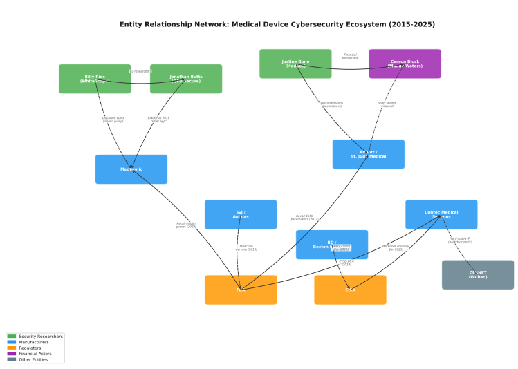
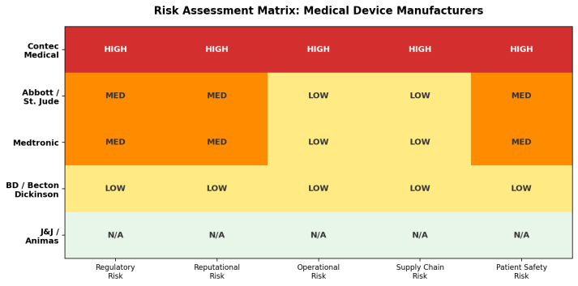
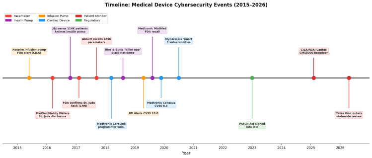
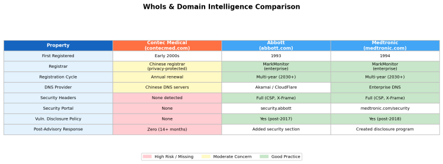

# Remotely Exploitable Medical Devices: A Decade of Threats to Human Life (2015–2025)

**OSINT / Threat Intelligence Investigation** · Final Project, OSINT Analyst Program
InsAIghts Academy by Penlink, in partnership with Google and Reichman AI Tech School · April 2026

📄 **[Read the full report (PDF)](report/Medical_Devices_OSINT_Report_Liron_Meoded.pdf)**

---

## Research Question

> How have remotely controllable medical devices been found vulnerable to exploitation over 2015–2025, what risks to human life have been demonstrated, and to what extent have manufacturers been aware of and responsive to these threats?

**Scope:** 4 device categories (cardiac implants, insulin pumps, patient monitors, infusion systems) · 5 manufacturers (Abbott/St. Jude, Medtronic, J&J/Animas, BD, Contec) · OSINT methods only, no active testing.

## Key Findings

1. **Every** major category of life-critical connected medical device was found remotely exploitable between 2015 and 2025, with CVSS scores reaching **9.3–10.0**.
2. Demonstrated attack capabilities include lethal insulin overdose, cardiac shock delivery, infusion dosage alteration and vital-signs falsification.
3. Vendor responses range from proactive (J&J warned 114,000 patients) to negligent (Contec: **no response for 14+ months** after a CISA/FDA backdoor advisory).
4. The barrier to exploitation is falling: specialist knowledge in 2015 → a smartphone app in 2018 → a built-in backdoor needing no exploitation in 2025.
5. No documented cyberattack has harmed a patient yet, but the technical capability is proven and the window of exposure remains open.

## Methodology

Seven OSINT research layers plus a Cyber Analyst Track. Every finding carries a confidence level: **Fact**, **Indication**, **Hypothesis** or **Conclusion**.

| Layer | What was done |
|---|---|
| Domain research | Regulatory landscape (FDA guidance, EU MDR, IEC 62443, PATCH Act) and key players |
| Trend analysis | 2015–2026 event timeline, Google Trends, keyword-shift analysis |
| Web & domain intelligence | WHOIS, DNS, sub-domains, security headers, Wayback Machine history, hard-coded IP investigation (Contec CMS8000) |
| Actor & entity network | Researcher / vendor / regulator / financial-actor relationship mapping |
| Corporate analysis | Official narrative vs. critical reading, media timeline, risk assessment per vendor |
| Product intelligence | Disclosure-to-patch timelines, attack complexity, competitor mapping |
| Geospatial intelligence | HQ verification, distribution mapping, IP geolocation |
| Threat monitoring | Threat-actor matrix (APT, ransomware, hacktivists, criminal) with likelihood |

## Visualizations

| Entity relationship network | Risk assessment matrix |
|---|---|
|  |  |

| Event timeline 2015–2026 | WHOIS & domain comparison |
|---|---|
|  |  |

All figures were generated in Python (Matplotlib).

## Recommendations (summary)

- **Healthcare organizations:** inventory connected devices against CISA/FDA advisories, segment medical devices on the network, require cybersecurity review in procurement.
- **Manufacturers:** security by design (encryption, authentication, secure boot), coordinated vulnerability disclosure programs, transparent patch timelines.
- **Regulators:** mandatory disclosure policies and a global medical-device vulnerability database.

## Tools & Sources

**OSINT:** WHOIS (DomainTools, who.is), DNS analysis, Wayback Machine, BuiltWith, Shodan, Google Dorking, Google Trends, Google Earth Pro, Baidu Maps, OpenStreetMap
**Vulnerability & regulatory data:** NIST NVD, CISA ICS-CERT / ICSMA advisories, MITRE CVE / CWE, Exploit-DB, FDA MAUDE, 510(k) and safety communications
**Corporate:** SEC EDGAR, corporate registries
**Analysis & visualization:** Python, Matplotlib, NumPy

---

*All information in this project comes from public sources. No device testing or exploitation was performed.*

**Author:** Liron Meoded · Cyber Threat Intelligence / OSINT
